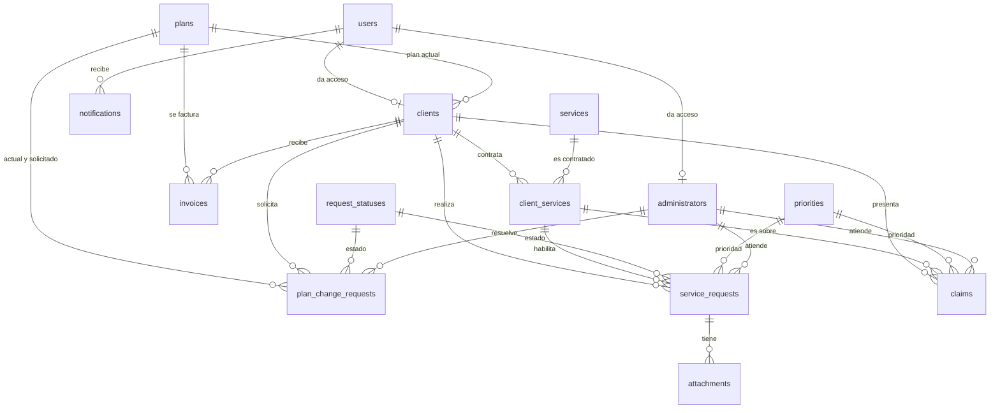
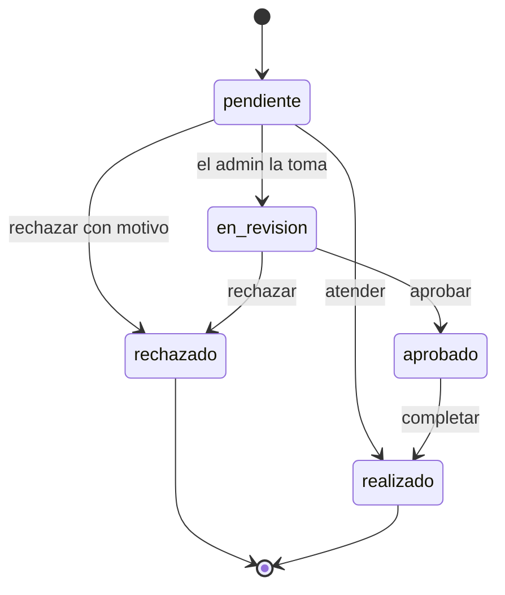

# Base de datos — Sistema de Gestión de Servicios Profesionales

| | |
|---|---|
| **Cliente** | Consultora Tech Solutions |
| **Equipo** | Da Vinci Labs |
| **Motor** | MySQL 8.0.16+ / MariaDB 10.2+ (InnoDB, `utf8mb4`) |
| **Fuente de verdad** | [`database/migrations/1_setup_database.sql`](../../database/migrations/1_setup_database.sql) |
| **Última actualización** | 2026-10-29 |

---

## 1. Qué es este documento

Este documento explica **la base de datos completa** del sistema: qué guarda cada tabla, para qué sirve cada campo, cómo se relacionan entre sí y qué reglas de negocio están garantizadas por el propio motor.

Está pensado para tres lectores distintos:

- **Quien programa:** encuentra el nombre exacto de cada campo, su tipo y sus restricciones.
- **Quien corrige o defiende el TP:** encuentra el porqué de cada decisión de diseño, conectado con los requerimientos y las historias de usuario.
- **Quien lee el `.sql`:** el esquema está en inglés, este documento en español. El glosario del final hace de puente.

---

## 2. Cómo leerlo

| Convención | Significado |
|---|---|
| `nombre_en_backticks` | Nombre literal de una tabla, columna o constraint |
| **Negrita** | Concepto importante |
| ✅ | Funcionalidad cubierta por el esquema |
| ⚠️ | Punto a revisar o decisión pendiente |
| `NULL` / `NOT NULL` | Si el campo admite vacío o no |
| `DEFAULT` | Valor que toma el campo si no se envía |
| RF-xx / USxx | Referencia al requerimiento funcional o historia de usuario |

**Tipos de clave que vas a ver:**

| Clave | Qué hace |
|---|---|
| `PRIMARY KEY` | Identifica la fila. Única, no nula, una por tabla |
| `UNIQUE KEY` | No permite repetidos (permite varios `NULL`) |
| `KEY` | Índice común: solo acelera búsquedas, no valida nada |
| `FOREIGN KEY` | Obliga a que el valor exista en otra tabla |
| `CHECK` | Regla de validación sobre los valores |

---

## 3. Panorama general

### 3.1 Números

| Dato | Valor |
|---|---|
| Tablas | **15** |
| Columnas totales | **106** |
| Catálogos (datos fijos) | 3 (`request_statuses`, `priorities`, `services`) |
| Tablas con datos de negocio | 12 |
| Charset | `utf8mb4` (soporta tildes, ñ y emojis) |
| Motor | InnoDB (transacciones y claves foráneas) |

### 3.2 Diagrama entidad-relación



> El diagrama muestra solo las relaciones. Los atributos de cada tabla están en la sección 4.

### 3.3 Resumen de las 15 tablas

| # | Tabla | Qué guarda | RF / US |
|---|---|---|---|
| 1 | `users` | Credenciales y rol de quien inicia sesión | US16, US17 |
| 2 | `plans` | Catálogo de planes (Básico, Profesional, Premium, Gratuito) | RF-06, US07 |
| 3 | `services` | Catálogo de servicios de consultoría | RF-06, US08 |
| 4 | `request_statuses` | Catálogo de estados de una solicitud | RF-10 |
| 5 | `priorities` | Catálogo de prioridades (alta, media, baja) | RF-07 |
| 6 | `clients` | Datos del cliente y su plan actual | RF-05, US06 |
| 7 | `administrators` | Datos del administrador | RF-04 |
| 8 | `client_services` | Qué servicios contrató cada cliente | RF-01, US01 |
| 9 | `service_requests` | Pedidos de modificación de un servicio | RF-02, US02, US09 |
| 10 | `plan_change_requests` | Pedidos de cambio de plan | RF-09, US13, US19 |
| 11 | `attachments` | Documentación adjunta a una solicitud | RF-03, US03 |
| 12 | `claims` | Reclamos de los clientes | RF-08, US04 |
| 13 | `invoices` | Facturas a enviar a PagoNet | RF-17, US20 |
| 14 | `integration_audit_logs` | Traza de cada llamada a un sistema externo | RF-20, US23 |
| 15 | `notifications` | Bandeja de entrada del usuario | RF-12, RF-13, US11, US12 |

---

## 4. Las tablas, una por una

El orden no es alfabético: es **orden de dependencias**. Cada tabla se explica después de las que necesita, así nunca aparece una referencia a algo que todavía no viste.

---

### 4.1 `users` — Usuarios del sistema

**Para qué sirve**
Guarda las credenciales de **toda persona que inicia sesión**, sea cliente o administrador. Es la puerta de entrada al sistema.

**Quién la usa**
US16 (login), US17 (registro), RNF-05 (solo usuarios autorizados administran).

**Campos**

| Campo | Tipo | Nulo | Default | Para qué |
|---|---|---|---|---|
| `id` | `INT UNSIGNED` | No | `AUTO_INCREMENT` | Identificador del usuario |
| `email` | `VARCHAR(255)` | No | — | Nombre de usuario para el login. Es único |
| `password_hash` | `VARCHAR(255)` | No | — | Contraseña **hasheada**, nunca en texto plano |
| `role` | `ENUM('client','admin')` | No | — | Define qué pantallas ve: cliente o administrador |
| `is_active` | `TINYINT(1)` | No | `1` | Permite bloquear una cuenta sin borrarla |
| `last_login_at` | `DATETIME` | Sí | `NULL` | Último ingreso. Alimenta el Reporte 5 |
| `created_at` | `DATETIME` | No | `CURRENT_TIMESTAMP` | Cuándo se creó la cuenta |
| `updated_at` | `DATETIME` | No | `CURRENT_TIMESTAMP ON UPDATE` | Se actualiza solo en cada modificación |

**Claves e índices**

- `PRIMARY KEY (id)`
- `UNIQUE KEY uq_users_email (email)` → no puede haber dos cuentas con el mismo email.

**Relaciones**

- **Es referenciada por:**
  - `clients.user_id` → un usuario puede tener un perfil de cliente.
  - `administrators.user_id` → un usuario puede tener un perfil de administrador.
  - `notifications.user_id` → recibe notificaciones.

**Reglas de negocio**

- Un usuario **no** guarda su nombre: el nombre vive en `clients.name` o `administrators.name`, según el rol.
- El rol de la tabla `users` y la existencia de la fila en `clients`/`administrators` deben mantenerse coherentes **desde la aplicación** (la base no puede validarlo entre tablas).
- Si se borra un usuario, su perfil de cliente queda con `user_id = NULL` (no se borra el cliente).

**Ejemplo de fila**

| id | email | password_hash | role | is_active | last_login_at |
|---|---|---|---|---|---|
| 1 | samantha@techsolutions.com | `pbkdf2:sha256:...` | admin | 1 | 2026-10-29 09:12:00 |
| 2 | mariana@ejemplo.com | `pbkdf2:sha256:...` | client | 1 | 2026-10-29 10:05:00 |

---

### 4.2 `plans` — Planes contratables

**Para qué sirve**
El catálogo de planes que ofrece la consultora. Cada cliente tiene **un** plan vigente.

**Quién la usa**
RF-06, US07 (gestión), US13/US19 (cambio de plan), Reporte 1.

**Campos**

| Campo | Tipo | Nulo | Default | Para qué |
|---|---|---|---|---|
| `id` | `INT UNSIGNED` | No | `AUTO_INCREMENT` | Identificador del plan |
| `name` | `VARCHAR(100)` | No | — | Nombre comercial: Básico, Profesional, Premium, Gratuito |
| `description` | `VARCHAR(500)` | Sí | `NULL` | Texto para mostrar en la pantalla de planes |
| `price` | `DECIMAL(12,2)` | No | — | Precio mensual. Se usa para facturar |
| `created_at` | `DATETIME` | No | `CURRENT_TIMESTAMP` | Alta del plan |
| `updated_at` | `DATETIME` | No | `CURRENT_TIMESTAMP ON UPDATE` | Última modificación |

**Claves e índices**

- `PRIMARY KEY (id)`
- `UNIQUE KEY uq_plans_name (name)` → no puede haber dos planes con el mismo nombre.
- `CHECK (price >= 0)` → un plan no puede tener precio negativo.

**Relaciones**

- **Es referenciada por:**
  - `clients.plan_id` → plan actual de cada cliente.
  - `plan_change_requests.current_plan_id` y `requested_plan_id`.
  - `invoices.plan_id` → qué plan se está facturando.

**Reglas de negocio**

- Un plan **no se puede borrar** si algún cliente lo tiene asignado (`ON DELETE RESTRICT`).
- `DECIMAL(12,2)` evita los errores de redondeo de `FLOAT` en dinero.
- El plan **Gratuito (id 4)** es el que recibe un visitante al registrarse (US17). La API lo referencia con `DEFAULT_PLAN_ID` en `api/app/constants.py`.

**Ejemplo de fila**

| id | name | description | price |
|---|---|---|---|
| 1 | Básico | Atención estándar, 1 servicio activo | 3500.00 |
| 2 | Profesional | Atención prioritaria, hasta 3 servicios | 5900.00 |
| 3 | Premium | Atención inmediata, servicios ilimitados | 7900.00 |
| 4 | Gratuito | Plan de bienvenida: acceso al sistema y al catálogo | 0.00 |

---

### 4.3 `services` — Catálogo de servicios

**Para qué sirve**
Los servicios de consultoría que la empresa puede ofrecer. Es el catálogo del que salen las contrataciones.

**Quién la usa**
RF-06, US08 (gestión), US01 (consulta), US02 (modificación), Reporte 4.

**Campos**

| Campo | Tipo | Nulo | Default | Para qué |
|---|---|---|---|---|
| `id` | `INT UNSIGNED` | No | `AUTO_INCREMENT` | Identificador del servicio |
| `name` | `VARCHAR(150)` | No | — | Nombre del servicio |
| `description` | `VARCHAR(500)` | Sí | `NULL` | Detalle de qué incluye |
| `created_at` | `DATETIME` | No | `CURRENT_TIMESTAMP` | Alta en el catálogo |
| `updated_at` | `DATETIME` | No | `CURRENT_TIMESTAMP ON UPDATE` | Última modificación |

**Claves e índices**

- `PRIMARY KEY (id)`
- `UNIQUE KEY uq_services_name (name)` → nombres únicos.

**Relaciones**

- **Es referenciada por:**
  - `client_services.service_id` → quién contrató este servicio.
  - `service_requests.service_id` (a través del par con `client_id`).
  - `claims.service_id`.

**Reglas de negocio**

- Un servicio **no se puede borrar** si está contratado (`ON DELETE RESTRICT`). Para retirarlo del catálogo hay que desactivarlo, no borrarlo.
- El catálogo inicial son los 8 servicios del caso de estudio.

**Ejemplo de fila**

| id | name | description |
|---|---|---|
| 1 | Consultoría en Finanzas y Contabilidad | Asesoría en gestión financiera y tributaria |
| 6 | Consultoría en Inteligencia Artificial y Machine Learning | Implementación de soluciones de IA para automatizar procesos |

---

### 4.4 `request_statuses` — Estados de una solicitud

**Para qué sirve**
Catálogo fijo con los estados posibles de una solicitud. Se usa tanto para solicitudes de modificación como para solicitudes de cambio de plan.

**Quién la usa**
RF-10, US05, US09, US14.

**Campos**

| Campo | Tipo | Nulo | Default | Para qué |
|---|---|---|---|---|
| `id` | `TINYINT UNSIGNED` | No | `AUTO_INCREMENT` | Identificador del estado |
| `name` | `VARCHAR(30)` | No | — | Nombre del estado |
| `description` | `VARCHAR(100)` | Sí | `NULL` | Explicación para mostrar al usuario |

**Claves e índices**

- `PRIMARY KEY (id)`
- `UNIQUE KEY uq_request_statuses_name (name)`

**Relaciones**

- **Es referenciada por:**
  - `service_requests.status_id`
  - `plan_change_requests.status_id`

**Reglas de negocio**

- Los `id` están **fijados a propósito** para que la aplicación pueda usarlos como constantes:

| id | name | Significado |
|---|---|---|
| 1 | `pendiente` | Recién creada, sin atender |
| 2 | `en_revision` | Un administrador la está analizando |
| 3 | `aprobado` | Aprobada, pendiente de ejecución |
| 4 | `rechazado` | Rechazada (con motivo) |
| 5 | `realizado` | Atendida y resuelta |

> ⚠️ En el código conviene comparar por `status_id`, no por `name`. Los IDs son estables; los nombres pueden cambiar.

**Ejemplo de fila**

| id | name | description |
|---|---|---|
| 1 | pendiente | Solicitud creada y pendiente de atención |
| 5 | realizado | Solicitud atendida y resuelta |

---

### 4.5 `priorities` — Prioridades

**Para qué sirve**
Catálogo de niveles de prioridad que un administrador puede asignar a una solicitud o a un reclamo.

**Quién la usa**
RF-07, US10 (asignar prioridad).

**Campos**

| Campo | Tipo | Nulo | Default | Para qué |
|---|---|---|---|---|
| `id` | `TINYINT UNSIGNED` | No | `AUTO_INCREMENT` | Identificador |
| `name` | `VARCHAR(30)` | No | — | alta, media, baja |
| `description` | `VARCHAR(100)` | Sí | `NULL` | Texto de ayuda |
| `level` | `TINYINT UNSIGNED` | No | — | Orden numérico: 1 es la más urgente |

**Claves e índices**

- `PRIMARY KEY (id)`
- `UNIQUE KEY uq_priorities_name (name)`

**Relaciones**

- **Es referenciada por:**
  - `service_requests.priority_id`
  - `claims.priority_id`

**Reglas de negocio**

- La prioridad es **opcional** en la solicitud (`NULL` hasta que el admin la asigna).
- `level` permite ordenar la bandeja sin depender del nombre.

**Ejemplo de fila**

| id | name | description | level |
|---|---|---|---|
| 1 | alta | Atender primero | 1 |
| 2 | media | Atención normal | 2 |
| 3 | baja | Atender cuando haya capacidad | 3 |

---

### 4.6 `clients` — Clientes

**Para qué sirve**
Los datos de cada cliente de la consultora y el plan que tiene contratado.

**Quién la usa**
RF-05, US06 (gestión), US01, US17 (registro), Reportes 1 y 5.

**Campos**

| Campo | Tipo | Nulo | Default | Para qué |
|---|---|---|---|---|
| `id` | `INT UNSIGNED` | No | `AUTO_INCREMENT` | Identificador del cliente |
| `user_id` | `INT UNSIGNED` | Sí | `NULL` | Usuario con el que inicia sesión. `NULL` = cliente sin acceso al sistema |
| `plan_id` | `INT UNSIGNED` | No | — | Plan vigente del cliente |
| `name` | `VARCHAR(150)` | No | — | Nombre o razón social |
| `email` | `VARCHAR(255)` | No | — | Email de contacto (puede ser distinto del de login) |
| `phone` | `VARCHAR(30)` | Sí | `NULL` | Teléfono. Necesario para notificaciones por SMS |
| `dni` | `VARCHAR(20)` | Sí | `NULL` | Documento. Se usa para validar identidad con VeriCheck |
| `created_at` | `DATETIME` | No | `CURRENT_TIMESTAMP` | Alta del cliente |
| `updated_at` | `DATETIME` | No | `CURRENT_TIMESTAMP ON UPDATE` | Última modificación |

**Claves e índices**

- `PRIMARY KEY (id)`
- `UNIQUE KEY uq_clients_user_id (user_id)` → un usuario no puede tener dos perfiles de cliente.
- `UNIQUE KEY uq_clients_email (email)`
- `UNIQUE KEY uq_clients_dni (dni)` → dos clientes no pueden compartir DNI. Se permiten varios `NULL`.
- `KEY idx_clients_plan_id (plan_id)` → acelera "clientes por plan" (Reporte 1).

**Relaciones**

- **Referencia a:**
  - `users.id` → `ON DELETE SET NULL` (si se borra el usuario, el cliente queda sin login).
  - `plans.id` → `ON DELETE RESTRICT`.
- **Es referenciada por:**
  - `client_services.client_id`
  - `service_requests.client_id`
  - `plan_change_requests.client_id`
  - `claims.client_id`
  - `invoices.client_id`

**Reglas de negocio**

- `plan_id` es obligatorio: **todo cliente tiene un plan**.
- Al registrarse desde el sistema, el cliente nace con el plan **Gratuito (id 4)** y **sin servicios contratados** (`client_services` vacío).
- El DNI se guarda **solo con dígitos** (`28456321`), sin puntos.
- `clients.email` es el email de contacto; `users.email` es el de login. Pueden coincidir, pero no son lo mismo.

**Ejemplo de fila**

| id | user_id | plan_id | name | email | phone | dni |
|---|---|---|---|---|---|---|
| 1 | 2 | 2 | Mariana Díaz | mariana@ejemplo.com | +54 911 2222 3333 | 28456321 |

---

### 4.7 `administrators` — Administradores

**Para qué sirve**
El perfil del personal de la consultora que atiende solicitudes. Separa los datos del administrador de sus credenciales.

**Quién la usa**
RF-04, US09, US14, US19.

**Campos**

| Campo | Tipo | Nulo | Default | Para qué |
|---|---|---|---|---|
| `id` | `INT UNSIGNED` | No | `AUTO_INCREMENT` | Identificador del administrador |
| `user_id` | `INT UNSIGNED` | No | — | Usuario con el que inicia sesión |
| `name` | `VARCHAR(150)` | No | — | Nombre para mostrar |
| `created_at` | `DATETIME` | No | `CURRENT_TIMESTAMP` | Alta |
| `updated_at` | `DATETIME` | No | `CURRENT_TIMESTAMP ON UPDATE` | Última modificación |

**Claves e índices**

- `PRIMARY KEY (id)`
- `UNIQUE KEY uq_administrators_user_id (user_id)`

**Relaciones**

- **Referencia a:** `users.id` → `ON DELETE RESTRICT`.
- **Es referenciada por:**
  - `service_requests.administrator_id` → `ON DELETE SET NULL` (la solicitud no se pierde).
  - `plan_change_requests.administrator_id` → `ON DELETE RESTRICT`.
  - `claims.administrator_id` → `ON DELETE SET NULL`.

**Reglas de negocio**

- Un administrador **siempre** tiene usuario (a diferencia del cliente, que puede no tenerlo).
- Para crear un admin hacen falta **dos filas**: una en `users` con `role = 'admin'` y otra acá.

**Ejemplo de fila**

| id | user_id | name |
|---|---|---|
| 1 | 1 | Samantha |

---

### 4.8 `client_services` — Servicios contratados

**Para qué sirve**
Resuelve la relación **muchos a muchos** entre clientes y servicios: qué contrató cada cliente. Es la tabla que responde "mis servicios".

**Quién la usa**
RF-01, US01, US02, US04, US05.

**Campos**

| Campo | Tipo | Nulo | Default | Para qué |
|---|---|---|---|---|
| `client_id` | `INT UNSIGNED` | No | — | Cliente |
| `service_id` | `INT UNSIGNED` | No | — | Servicio contratado |
| `contracted_at` | `DATETIME` | No | `CURRENT_TIMESTAMP` | Cuándo lo contrató |

**Claves e índices**

- `PRIMARY KEY (client_id, service_id)` → **clave compuesta**: un cliente no puede contratar dos veces el mismo servicio.
- `KEY idx_client_services_service_id (service_id)` → necesario para buscar por servicio, porque la PK empieza por `client_id`.

**Relaciones**

- **Referencia a:**
  - `clients.id` → `ON DELETE CASCADE` (si se borra el cliente, se borran sus contrataciones).
  - `services.id` → `ON DELETE RESTRICT`.
- **Es referenciada por:**
  - `service_requests (client_id, service_id)` → **FK compuesta**.
  - `claims (client_id, service_id)` → **FK compuesta**.

**Reglas de negocio**

- Esta tabla es la **llave de integridad** del sistema: gracias a la FK compuesta, es imposible crear una solicitud sobre un servicio que el cliente no contrató.
- Si un cliente deja de usar un servicio, **no se borra la fila** mientras tenga solicitudes o reclamos asociados (`RESTRICT`).

**Ejemplo de fila**

| client_id | service_id | contracted_at |
|---|---|---|
| 1 | 3 | 2026-10-01 10:00:00 |
| 1 | 6 | 2026-10-15 16:30:00 |

---

### 4.9 `service_requests` — Solicitudes de modificación

**Para qué sirve**
Una fila por cada pedido de cambio que un cliente hace sobre un servicio que tiene contratado. Es la tabla central del sistema.

**Quién la usa**
RF-02, RF-04, RF-10, RF-11, US02 (crear), US05 (consultar), US09 (atender), US14 (listar).

**Campos**

| Campo | Tipo | Nulo | Default | Para qué |
|---|---|---|---|---|
| `id` | `INT UNSIGNED` | No | `AUTO_INCREMENT` | Número de solicitud |
| `client_id` | `INT UNSIGNED` | No | — | Quién la pide |
| `service_id` | `INT UNSIGNED` | No | — | Sobre qué servicio |
| `status_id` | `TINYINT UNSIGNED` | No | `1` | Estado actual. Nace en **pendiente** |
| `priority_id` | `TINYINT UNSIGNED` | Sí | `NULL` | Prioridad, la asigna el administrador |
| `administrator_id` | `INT UNSIGNED` | Sí | `NULL` | Quién la atendió |
| `modification_type` | `VARCHAR(100)` | No | — | Tipo de cambio pedido (horario, alcance, etc.) |
| `description` | `TEXT` | Sí | `NULL` | Detalle libre del pedido |
| `rejection_reason` | `VARCHAR(500)` | Sí | `NULL` | Motivo, obligatorio si se rechaza |
| `created_at` | `DATETIME` | No | `CURRENT_TIMESTAMP` | Fecha de ingreso |
| `updated_at` | `DATETIME` | No | `CURRENT_TIMESTAMP ON UPDATE` | Última modificación |
| `resolved_at` | `DATETIME` | Sí | `NULL` | Cuándo se resolvió. Permite calcular el tiempo real |

**Claves e índices**

- `PRIMARY KEY (id)`
- `KEY idx_service_requests_client (client_id, created_at)` → "mis solicitudes, la más nueva primero".
- `KEY idx_service_requests_service (service_id)`
- `KEY idx_service_requests_status_priority (status_id, priority_id)` → bandeja del admin ordenada por prioridad.
- `KEY idx_service_requests_administrator (administrator_id)`
- FK compuesta `(client_id, service_id)` → `client_services`.

**Relaciones**

- **Referencia a:**
  - `client_services (client_id, service_id)` → `ON DELETE RESTRICT`.
  - `request_statuses.id` → `ON DELETE RESTRICT`.
  - `priorities.id` → `ON DELETE RESTRICT`.
  - `administrators.id` → `ON DELETE SET NULL`.
- **Es referenciada por:** `attachments.request_id` → `ON DELETE CASCADE`.

**Reglas de negocio**

- Nace **siempre** con `status_id = 1` (pendiente).
- El par (`client_id`, `service_id`) debe existir en `client_services`.
- Al atender: `status_id = 5` (realizado) y `resolved_at = NOW()`.
- Al rechazar: `status_id = 4` (rechazado), `rejection_reason` obligatorio y `resolved_at = NOW()`.
- El tiempo de atención se calcula como `resolved_at - created_at`.

**Ejemplo de fila**

| id | client_id | service_id | status_id | priority_id | modification_type | description |
|---|---|---|---|---|---|---|
| 1 | 1 | 3 | 1 | 2 | Cambio de horario | Mover la reunión al viernes |

---

### 4.10 `plan_change_requests` — Solicitudes de cambio de plan

**Para qué sirve**
Registra los pedidos de upgrade/downgrade de plan, con el resultado de la validación de identidad y la aprobación del administrador.

**Quién la usa**
RF-09, RF-15, RF-16, US13, US18, US19.

**Campos**

| Campo | Tipo | Nulo | Default | Para qué |
|---|---|---|---|---|
| `id` | `INT UNSIGNED` | No | `AUTO_INCREMENT` | Número de solicitud |
| `client_id` | `INT UNSIGNED` | No | — | Quién la pide |
| `current_plan_id` | `INT UNSIGNED` | No | — | Plan que tiene hoy |
| `requested_plan_id` | `INT UNSIGNED` | No | — | Plan al que quiere pasar |
| `status_id` | `TINYINT UNSIGNED` | No | `1` | Estado. Nace en **pendiente** |
| `administrator_id` | `INT UNSIGNED` | Sí | `NULL` | Quién la aprobó o rechazó |
| `reason` | `VARCHAR(500)` | Sí | `NULL` | Motivo del pedido |
| `identity_verified` | `TINYINT(1)` | No | `0` | Resultado de VeriCheck: 0 = no validado, 1 = validado |
| `created_at` | `DATETIME` | No | `CURRENT_TIMESTAMP` | Fecha del pedido |
| `resolved_at` | `DATETIME` | Sí | `NULL` | Cuándo se resolvió |

**Claves e índices**

- `PRIMARY KEY (id)`
- `KEY idx_plan_change_requests_client`, `..._current_plan`, `..._requested_plan`, `..._status`, `..._administrator`.
- `CHECK (current_plan_id <> requested_plan_id)` → no se puede pedir el plan que ya se tiene.

**Relaciones**

- **Referencia a:** `clients`, `plans` (dos veces), `request_statuses`, `administrators`.

**Reglas de negocio**

- No se puede pedir un cambio al mismo plan (`CHECK`).
- La solicitud solo se registra si `identity_verified = 1`.
- Al aprobar: se actualiza `clients.plan_id` con `requested_plan_id` y se genera la factura.
- Al rechazar: no se contacta a PagoNet.
- ⚠️ No tiene `updated_at` (el resto de las tablas sí).

**Ejemplo de fila**

| id | client_id | current_plan_id | requested_plan_id | status_id | identity_verified |
|---|---|---|---|---|---|
| 1 | 1 | 2 | 3 | 1 | 1 |

---

### 4.11 `attachments` — Documentación adjunta

**Para qué sirve**
Guarda los archivos (PDF, imágenes) que el cliente adjunta a una solicitud. El archivo en sí vive en disco; acá se guarda la referencia.

**Quién la usa**
RF-03, US03.

**Campos**

| Campo | Tipo | Nulo | Default | Para qué |
|---|---|---|---|---|
| `id` | `INT UNSIGNED` | No | `AUTO_INCREMENT` | Identificador |
| `request_id` | `INT UNSIGNED` | No | — | Solicitud a la que pertenece |
| `file_name` | `VARCHAR(255)` | No | — | Nombre original del archivo |
| `file_path` | `VARCHAR(500)` | No | — | Ruta donde quedó guardado |
| `file_type` | `VARCHAR(100)` | No | — | MIME type (`application/pdf`, `image/png`) |
| `uploaded_at` | `DATETIME` | No | `CURRENT_TIMESTAMP` | Cuándo se subió |

**Claves e índices**

- `PRIMARY KEY (id)`
- `KEY idx_attachments_request_id (request_id)`

**Relaciones**

- **Referencia a:** `service_requests.id` → `ON DELETE CASCADE` (si se borra la solicitud, se borran sus adjuntos).

**Reglas de negocio**

- La validación de formato se hace en la aplicación usando `file_type`.
- ⚠️ Hoy solo se puede adjuntar a una **solicitud de modificación**, no a un reclamo ni a un cambio de plan.

**Ejemplo de fila**

| id | request_id | file_name | file_path | file_type |
|---|---|---|---|---|
| 1 | 1 | contrato-2026.pdf | /uploads/2026/10/contrato-2026.pdf | application/pdf |

---

### 4.12 `claims` — Reclamos

**Para qué sirve**
Registra las quejas de los clientes sobre un servicio, con su categoría, prioridad y estado.

**Quién la usa**
RF-08, US04, Reporte 3.

**Campos**

| Campo | Tipo | Nulo | Default | Para qué |
|---|---|---|---|---|
| `id` | `INT UNSIGNED` | No | `AUTO_INCREMENT` | Identificador |
| `client_id` | `INT UNSIGNED` | No | — | Quién reclama |
| `service_id` | `INT UNSIGNED` | Sí | `NULL` | Sobre qué servicio |
| `priority_id` | `TINYINT UNSIGNED` | Sí | `NULL` | Prioridad inicial |
| `administrator_id` | `INT UNSIGNED` | Sí | `NULL` | Responsable asignado |
| `category` | `ENUM('technical','support','service','other')` | No | `'other'` | Tipo de reclamo |
| `description` | `TEXT` | No | — | Motivo del reclamo |
| `status` | `ENUM('pending','resolved','closed')` | No | `'pending'` | Estado del reclamo |
| `created_at` | `DATETIME` | No | `CURRENT_TIMESTAMP` | Fecha del reclamo |
| `resolved_at` | `DATETIME` | Sí | `NULL` | Cuándo se resolvió |

**Claves e índices**

- `PRIMARY KEY (id)`
- `KEY idx_claims_client (client_id, created_at)`, `..._status`, `..._priority`, `..._administrator`.
- FK compuesta `(client_id, service_id)` → `client_services`.

**Relaciones**

- **Referencia a:** `clients`, `client_services (client_id, service_id)`, `priorities`, `administrators`.

**Reglas de negocio**

- `service_id` es opcional: se permite un reclamo general sin servicio.
- Si `service_id` tiene valor, el par debe existir en `client_services`.
- El tiempo de respuesta es `resolved_at - created_at`.
- ⚠️ `category` y `status` están en **inglés** (`ENUM`), a diferencia de `request_statuses` que está en español. Es una inconsistencia a unificar.

**Ejemplo de fila**

| id | client_id | service_id | category | description | status |
|---|---|---|---|---|---|
| 1 | 1 | 3 | service | La reunión se canceló sin aviso | pending |

---

### 4.13 `invoices` — Facturas

**Para qué sirve**
Registra la información de facturación que se envía a PagoNet y el estado de esa entrega, para poder reintentar si falla.

**Quién la usa**
RF-17, US20.

**Campos**

| Campo | Tipo | Nulo | Default | Para qué |
|---|---|---|---|---|
| `id` | `INT UNSIGNED` | No | `AUTO_INCREMENT` | Identificador |
| `client_id` | `INT UNSIGNED` | No | — | A quién se factura |
| `plan_id` | `INT UNSIGNED` | No | — | Qué plan se factura |
| `amount` | `DECIMAL(12,2)` | No | — | Monto a facturar |
| `issued_at` | `DATE` | No | — | Fecha de emisión |
| `sync_status` | `ENUM('pending','sent','failed')` | No | `'pending'` | Estado del envío a PagoNet |
| `sent_at` | `DATETIME` | Sí | `NULL` | Cuándo se envió |
| `created_at` | `DATETIME` | No | `CURRENT_TIMESTAMP` | Alta del registro |

**Claves e índices**

- `PRIMARY KEY (id)`
- `KEY idx_invoices_client (client_id, issued_at)`, `..._plan`, `..._sync_status` (cola de reintento).
- `CHECK (amount >= 0)`.

**Relaciones**

- **Referencia a:** `clients.id`, `plans.id`.

**Reglas de negocio**

- `sync_status = 'pending'` significa "pendiente de envío o de reintento".
- Si PagoNet falla, la solicitud de cambio de plan queda aprobada igual y la factura queda en `pending` o `failed`.
- ⚠️ Contradice el balanceo del parcial, que concluyó que la factura **no se persiste** (la lleva PagoNet). Hay que decidir una versión.
- ⚠️ No guarda el `service_id` ni el `plan_change_request_id`, así que no se puede rastrear qué aprobación generó la factura.

**Ejemplo de fila**

| id | client_id | plan_id | amount | issued_at | sync_status |
|---|---|---|---|---|---|
| 1 | 1 | 3 | 7900.00 | 2026-10-29 | pending |

---

### 4.14 `integration_audit_logs` — Auditoría de integraciones

**Para qué sirve**
Una fila por **cada intento** de comunicación con un sistema externo: qué se envió, qué respondió, si falló y cuántas veces se reintentó. Es la traza técnica del sistema.

**Quién la usa**
RF-20, RNF-07, US23.

**Campos**

| Campo | Tipo | Nulo | Default | Para qué |
|---|---|---|---|---|
| `id` | `BIGINT UNSIGNED` | No | `AUTO_INCREMENT` | Identificador (BIGINT porque crece rápido) |
| `system_name` | `VARCHAR(30)` | No | — | PagoNet, CRMMax, NotiSys, AnalytixPro, VeriCheck, WhatsApp, API |
| `direction` | `ENUM('outbound','inbound')` | No | — | Si el sistema llamó o fue llamado |
| `http_method` | `VARCHAR(10)` | Sí | `NULL` | GET, POST... |
| `endpoint` | `VARCHAR(500)` | Sí | `NULL` | URL llamada |
| `request_payload` | `JSON` | Sí | `NULL` | Cuerpo enviado |
| `response_status` | `SMALLINT UNSIGNED` | Sí | `NULL` | Código HTTP de respuesta |
| `response_body` | `JSON` | Sí | `NULL` | Cuerpo recibido |
| `status` | `ENUM('success','failed','retry_pending')` | No | — | Resultado del intento |
| `error_message` | `VARCHAR(1000)` | Sí | `NULL` | Detalle del error |
| `retry_count` | `TINYINT UNSIGNED` | No | `0` | Cuántas veces se reintentó |
| `created_at` | `DATETIME` | No | `CURRENT_TIMESTAMP` | Cuándo ocurrió |

**Claves e índices**

- `PRIMARY KEY (id)`
- `KEY idx_integration_audit_logs_system_date (system_name, created_at)` → "qué pasó con PagoNet esta semana".
- `KEY idx_integration_audit_logs_status (status)` → cola de reintentos.

**Relaciones**

- **Sin claves foráneas.** Es un log: no debe depender de nada para no perder registros.

**Reglas de negocio**

- `status = 'retry_pending'` es la cola de reintento: `WHERE status = 'retry_pending' AND retry_count < 3`.
- No guarda el `notification_id` ni el `invoice_id`: es traza técnica, no vínculo de negocio.

**Ejemplo de fila**

| id | system_name | direction | http_method | endpoint | status | retry_count |
|---|---|---|---|---|---|---|
| 1 | NotiSys | outbound | POST | https://api.notisys.com/send | success | 0 |

---

### 4.15 `notifications` — Bandeja de entrada

**Para qué sirve**
El aviso que ve el usuario en el campanito de la barra superior. Una fila por destinatario.

**Quién la usa**
RF-12, RF-13, US11, US12.

**Campos**

| Campo | Tipo | Nulo | Default | Para qué |
|---|---|---|---|---|
| `id` | `BIGINT UNSIGNED` | No | `AUTO_INCREMENT` | Identificador |
| `user_id` | `INT UNSIGNED` | No | — | Destinatario |
| `message` | `VARCHAR(500)` | No | — | Texto del aviso |
| `is_read` | `TINYINT(1)` | No | `0` | 0 = no leída, 1 = leída |
| `created_at` | `DATETIME` | No | `CURRENT_TIMESTAMP` | Cuándo se generó |

**Claves e índices**

- `PRIMARY KEY (id)`
- `KEY idx_notifications_user (user_id, is_read)` → sirve para la bandeja y para el contador.

**Relaciones**

- **Referencia a:** `users.id` → `ON DELETE CASCADE`.

**Reglas de negocio**

- Al abrir la bandeja se marcan **todas** como leídas: `UPDATE ... SET is_read = 1 WHERE user_id = ? AND is_read = 0`.
- El contador del campanito es `COUNT(*) WHERE user_id = ? AND is_read = 0`.
- Solo hay notificaciones **dentro de la app**. El envío por email/SMS se registra en `integration_audit_logs`.

**Ejemplo de fila**

| id | user_id | message | is_read |
|---|---|---|---|
| 1 | 2 | Tu solicitud #1 pasó a realizado | 0 |

---

## 5. Catálogos y estados

### 5.1 Estados de una solicitud



**Para el Sprint 1 solo se usan tres transiciones:**

| Desde | Hasta | Acción | Campos que se escriben |
|---|---|---|---|
| `pendiente` (1) | `realizado` (5) | Aprobar / atender | `resolved_at`, `administrator_id` |
| `pendiente` (1) | `rechazado` (4) | Rechazar | `rejection_reason`, `resolved_at`, `administrator_id` |
| — | `pendiente` (1) | Crear solicitud | `status_id = 1` por defecto |

Las transiciones con `en_revision` y `aprobado` quedan disponibles para el Slice 2.

### 5.2 Prioridades

| id | name | level | Cuándo se usa |
|---|---|---|---|
| 1 | alta | 1 | Cliente Premium o urgencia declarada |
| 2 | media | 2 | Caso normal |
| 3 | baja | 3 | Mejora sin apuro |

### 5.3 Categorías de reclamo

| Valor (`ENUM`) | Significado |
|---|---|
| `technical` | Falla del sistema |
| `support` | Problema de atención |
| `service` | Problema con el servicio prestado |
| `other` | Otro |

---

## 6. Datos iniciales (seed)

El script carga estos datos fijos. **No son datos de prueba**: son catálogos que la aplicación necesita para funcionar.

| Tabla | Filas | Contenido |
|---|---|---|
| `request_statuses` | 5 | pendiente, en_revision, aprobado, rechazado, realizado |
| `priorities` | 3 | alta, media, baja |
| `services` | 8 | Catálogo del caso de estudio |
| `plans` | 4 | Básico (3500), Profesional (5900), Premium (7900), Gratuito (0) |

> **Importante:** `plans` no es opcional. `clients.plan_id` es `NOT NULL`, así que sin planes no se puede crear ningún cliente.

**Datos de demo (se cargan aparte, no en el script):**

```
1 usuario admin      + 1 fila en administrators
1 usuario cliente    + 1 fila en clients (con plan)
2 o 3 filas en client_services
```

---

## 7. Consultas frecuentes

### Login

```sql
SELECT id, email, password_hash, role, is_active
FROM users
WHERE email = ?;
```

### Servicios contratados de un cliente (US01)

```sql
SELECT s.id, s.name, s.description, cs.contracted_at
FROM client_services cs
JOIN services s ON s.id = cs.service_id
WHERE cs.client_id = ?
ORDER BY s.name;
```

### Crear una solicitud (US02)

```sql
INSERT INTO service_requests
  (client_id, service_id, status_id, modification_type, description)
VALUES (?, ?, 1, ?, ?);
```

> Si el cliente no contrató ese servicio, la FK compuesta rechaza el `INSERT`.

### Bandeja del administrador, por prioridad (US14)

```sql
SELECT r.id, c.name AS cliente, s.name AS servicio,
       st.name AS estado, p.name AS prioridad, r.created_at
FROM service_requests r
JOIN clients c          ON c.id = r.client_id
JOIN services s         ON s.id = r.service_id
JOIN request_statuses st ON st.id = r.status_id
LEFT JOIN priorities p  ON p.id = r.priority_id
WHERE r.status_id = 1
ORDER BY p.level ASC, r.created_at ASC;
```

### Atender una solicitud (US09)

```sql
-- Aprobar
UPDATE service_requests
SET status_id = 5, administrator_id = ?, resolved_at = NOW()
WHERE id = ?;

-- Rechazar
UPDATE service_requests
SET status_id = 4, administrator_id = ?, rejection_reason = ?, resolved_at = NOW()
WHERE id = ?;
```

### Contador del campanito y bandeja (US11/US12)

```sql
SELECT COUNT(*) FROM notifications WHERE user_id = ? AND is_read = 0;

SELECT id, message, is_read, created_at
FROM notifications
WHERE user_id = ?
ORDER BY created_at DESC
LIMIT 50;

UPDATE notifications SET is_read = 1 WHERE user_id = ? AND is_read = 0;
```

### Reintentos pendientes de integraciones (RF-20)

```sql
SELECT id, system_name, endpoint, retry_count, error_message
FROM integration_audit_logs
WHERE status = 'retry_pending' AND retry_count < 3
ORDER BY created_at;
```

### Métricas diarias para AnalytixPro (US22)

```sql
SELECT
  (SELECT COUNT(*) FROM clients) AS total_clientes,
  (SELECT COUNT(*) FROM clients WHERE DATE(created_at) = CURDATE()) AS nuevos_registros,
  (SELECT COUNT(*) FROM service_requests WHERE DATE(created_at) = CURDATE()) AS solicitudes_nuevas,
  (SELECT AVG(TIMESTAMPDIFF(MINUTE, created_at, resolved_at))
     FROM service_requests WHERE resolved_at IS NOT NULL) AS minutos_promedio,
  (SELECT COUNT(*) FROM plan_change_requests WHERE DATE(created_at) = CURDATE()) AS cambios_de_plan,
  (SELECT COUNT(*) FROM claims WHERE status = 'pending') AS reclamos_abiertos;
```

---

## 8. Decisiones tomadas y puntos pendientes

### 8.1 Decisiones

| Decisión | Motivo |
|---|---|
| `ON UPDATE RESTRICT` en todas las FK | MariaDB rechaza un `CHECK` que referencia una FK con `ON UPDATE CASCADE` (error 1901). Los IDs son `AUTO_INCREMENT` y nunca cambian, así que `RESTRICT` es equivalente en la práctica y funciona en ambos motores |
| FK compuesta `(client_id, service_id)` | Garantiza que nadie pida cambios sobre un servicio que no contrató. Es la integridad más importante del sistema |
| Esquema en inglés, datos en español | Nombres técnicos consistentes; textos visibles para el usuario en su idioma |
| IDs de catálogos fijos | La aplicación puede usar constantes (`PENDIENTE = 1`, `REALIZADO = 5`) sin consultar la tabla |
| `notifications` minimalista | Solo bandeja interna. La traza de envío va a `integration_audit_logs` |
| `BIGINT` en logs y notificaciones | Crecen mucho más rápido que las tablas de negocio |
| Plan Gratuito (id 4) | Permite registrar visitantes sin violar `clients.plan_id NOT NULL`; es gratis, así que no genera factura |

### 8.2 Pendientes

| Tema | Estado |
|---|---|
| `invoices` vs. el parcial | ⚠️ El parcial dice que la factura no se persiste; la tabla existe. Decidir una versión |
| Campos del Reporte 1 | ⚠️ Faltan `plans.status`, `plans.credits`, `plans.response_time`, `clients.plan_started_at` |
| `clients.plan_id NOT NULL` | ✅ Resuelto: al registrarse se asigna el plan Gratuito (id 4), sin servicios |
| Verificación de email | ⚠️ No hay columna: la cuenta queda activa apenas se registra |
| Usuario recién registrado sin servicios | ⚠️ No existe flujo de contratación; el admin carga `client_services` |
| Plan Gratuito | ⚠️ Decisión de producto: no está en el caso de estudio, se agregó para cumplir `plan_id NOT NULL` |
| `claims` en inglés | ⚠️ `category` y `status` usan `ENUM` en inglés, distinto del resto |
| Autorización de API externa | ⚠️ No hay tabla de credenciales para US15 |
| Identidad en reclamos | ⚠️ `identity_verified` solo existe en `plan_change_requests` (US18) |
| Datos de facturación | ⚠️ `invoices` no guarda `service_id` ni `plan_change_request_id` (US20) |
| Adjuntos en reclamos | ⚠️ `attachments` solo apunta a `service_requests` |

---

## 9. Glosario

| Inglés | Español |
|---|---|
| `users` | Usuarios |
| `plans` | Planes |
| `services` | Servicios |
| `request_statuses` | Estados de solicitud |
| `priorities` | Prioridades |
| `clients` | Clientes |
| `administrators` | Administradores |
| `client_services` | Servicios contratados |
| `service_requests` | Solicitudes de modificación |
| `plan_change_requests` | Solicitudes de cambio de plan |
| `attachments` | Documentación adjunta |
| `claims` | Reclamos |
| `invoices` | Facturas |
| `integration_audit_logs` | Auditoría de integraciones |
| `notifications` | Notificaciones |

| Término | Significado |
|---|---|
| **FK** | Foreign Key: obliga a que el valor exista en otra tabla |
| **PK** | Primary Key: identifica la fila |
| **Seed** | Datos iniciales que carga el script |
| **SLA** | Tiempo de respuesta comprometido según el plan |
| **VeriCheck** | Servicio externo de validación de identidad |
| **PagoNet** | Servicio externo de facturación |
| **NotiSys** | Servicio externo de notificaciones |
| **CRMMax** | Servicio externo de gestión de clientes |
| **AnalytixPro** | Servicio externo de métricas |

---

*Documento generado a partir de `database/migrations/1_setup_database.sql`. Si el esquema cambia, este documento debe actualizarse en el mismo commit.*
